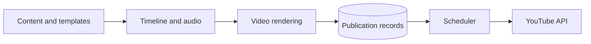

# Autonomous AI Content Production

**Engineering case study · Python · MoviePy / FFmpeg · PostgreSQL · API integration**

A personal software project designed to transform reusable narrative configurations and content assets into narrated videos, coordinate their publication, and maintain traceable production records.

## Real-world production showcase

[**Watch the live production output on YouTube — OraciónDiaria1Minuto**](https://www.youtube.com/@OracionDiaria1Minuto/shorts)

| Channel metric | Result |
| --- | ---: |
| Views over 365 days | **234.6K** |
| Current subscribers | **1,967** |
| Watch time over 365 days | **~1,200 hours** |
| Channel video catalog (owner-reported) | **~567 videos** |

The catalog includes approximately 440 Shorts and 127 videos longer than three minutes, as reported by the owner.

Audience figures come from owner-provided YouTube Studio screenshots captured on November 27, 2026. The 365-day reporting window is November 27, 2025 through November 26, 2026. Rounded figures reflect the Studio display.

These are channel-level outcomes, not a measurement of pipeline throughput. The number of automatically generated and publicly published videos, operational reliability and production costs remain subject to separate verification.

## The engineering challenge

Producing videos repeatedly involves more than generating text: narration, visual timing, background music, metadata, publication calendars and external API interactions must work together. This project separates those responsibilities into a configuration-driven generation engine and a publication workflow.

## Solution

- Reusable narrative templates and channel-specific content catalogs.
- Timeline-based composition of speech, images, synchronized text and music.
- MoviePy/FFmpeg rendering to H.264 video and AAC audio.
- PostgreSQL-backed content and publication tracking.
- Rule-based scheduling and YouTube API integration.
- AI-assisted metadata enrichment and thumbnail generation.

## What this demonstrates

Backend engineering, external service integration, media automation, configuration-driven design, separation of responsibilities, and operational troubleshooting.

This is an independent project, not a commissioned client engagement. Its output demonstrates automated audiovisual composition, not AI-generated product motion or advertising fidelity.

## Case study documentation

- [Architecture and technology](docs/architecture.md)
- [Engineering decisions, testing and reliability](docs/engineering-and-reliability.md)
- [Results and evidence](docs/results-and-evidence.md)

## Evidence and scope

The technical description is based on inspection of the original project's development branch on 27 November 2026. Operational production metrics and the deployed revision remain subject to separate verification; channel audience metrics are documented above. The original source code, credentials and operational configuration are not distributed in this repository.

**Review status:** channel audience evidence incorporated; operational evidence and publication approval pending.
