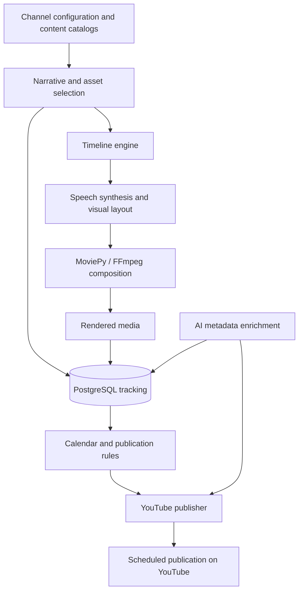

# Architecture

This case study describes the reviewed development snapshot, not a verified inventory of the live deployment.

## Component responsibilities

| Component | Responsibility |
| --- | --- |
| Narrative configuration | Reusable templates and channel-specific catalogs |
| Timeline engine | Resolve narrative blocks and coordinate timing |
| Audio and visuals | Speech, music, timed image layers and text layout |
| Renderer | Compose media and encode H.264/AAC output |
| Persistence | Track content identity, usage and publication records |
| Scheduler | Apply channel calendars, time zones and platform rules |
| Publisher | Upload rendered assets and schedule publication through YouTube |
| Metadata enrichment | Generate and validate titles and thumbnail layouts |

The diagram is a simplified logical view; it does not imply that every component runs in a separate service. The design separates media generation from publication rather than requiring rendering during an upload request.

## Technology

Python, MoviePy, FFmpeg, PostgreSQL/psycopg, OpenAI integration, YouTube API and pytest are supported by the reviewed repository. Speech-provider modules exist, including Edge TTS and ElevenLabs; the provider active in production has not been confirmed.

## Design trade-offs

Configuration-driven content avoids duplicating the generation pipeline for each channel. A shared timeline coordinates media timing. Persistence gives scheduling and publishing an explicit record to work from. The publisher is separate from narrative generation, enabling independent troubleshooting. These choices do not by themselves establish horizontal scalability or exactly-once delivery.
