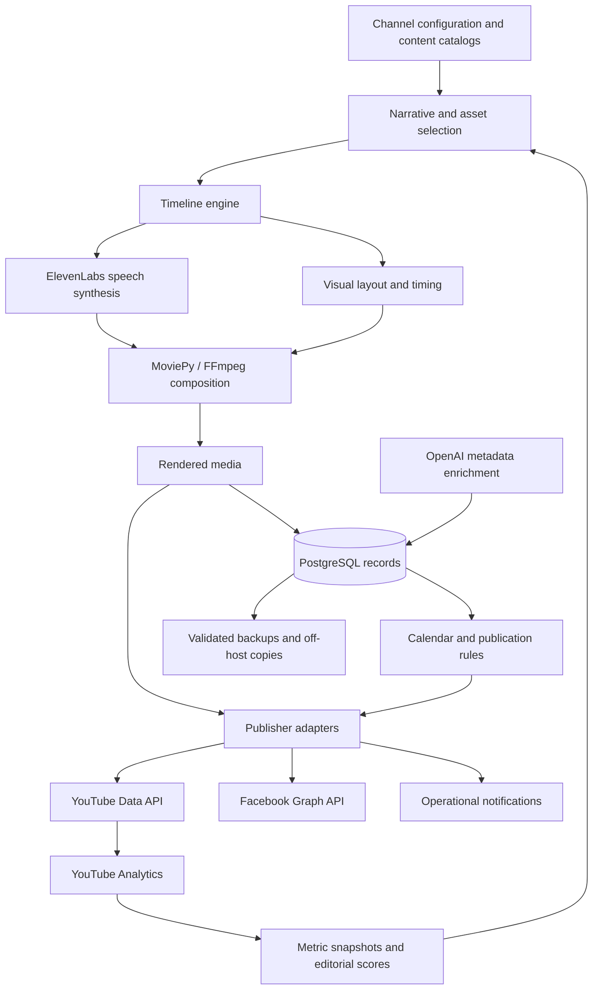

# Architecture

Logical architecture based on development source inspection and the owner-supplied production audit of November 27, 2026.

## Component responsibilities

| Component | Responsibility |
| --- | --- |
| Narrative configuration | Reusable templates and channel-specific catalogs |
| Timeline engine | Coordinate narration, timed visual layers and music |
| Renderer | Compose images and text with speech and background audio; encode H.264/AAC |
| PostgreSQL | Track content identity, publication state and metrics |
| Scheduler | Apply channel calendars, time zones and platform rules |
| Publisher adapters | Submit media to YouTube and Facebook |
| Metadata enrichment | AI-assisted titles, descriptions and thumbnail layouts |
| Analytics feedback | Store cumulative snapshots and compute editorial scores |
| Operations | Scheduled jobs, notifications, backup and recovery |

## Observed technology stack

Python 3.12, MoviePy 1.0.3, FFmpeg 6.1.1, Pillow, NumPy, PostgreSQL 16, psycopg, Docker, OpenAI SDK, ElevenLabs, YouTube Data and Analytics APIs, Facebook Graph API, Telegram notifications, cron and systemd. Backup tooling includes pg_dump/pg_restore and off-host synchronization.

## Design trade-offs

The production design uses a single-host deployment and separates generation from publication. PostgreSQL coordinates publication work without a dedicated broker. Development is isolated from production through separate data and network controls. Platform-side scheduling permits already accepted content to be released without continuous host availability, but generation and metric collection still depend on local job execution.

The diagram is logical rather than a deployment topology. It does not imply separate microservices, horizontal scaling, high availability, or a formal CI/CD release pipeline. The audited production and development revisions differ.
