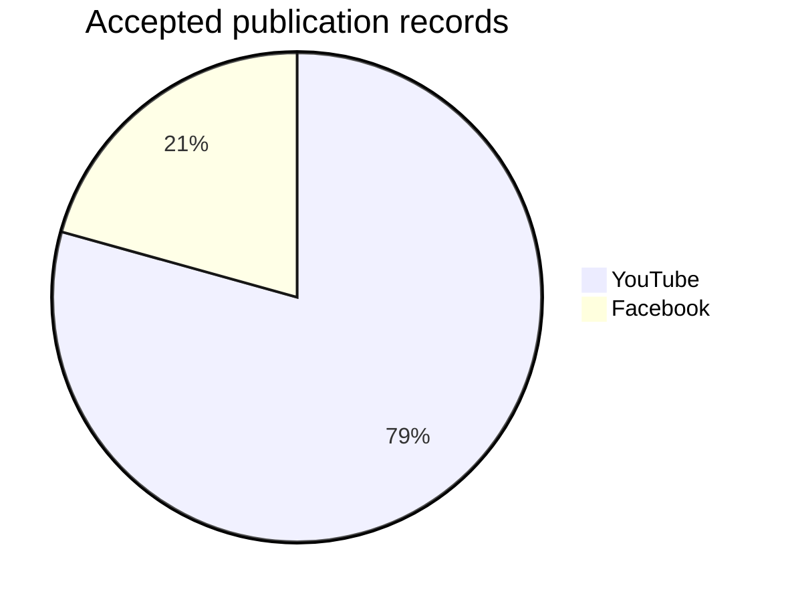

# Production metrics

Snapshot: November 27, 2026. Source: read-only production audit and metrics extraction supplied by the project owner. Figures describe the audited records, not a new platform reconciliation.

## Operational inventory

| Metric | Value |
| --- | ---: |
| Recorded activity window (Jan 27–Nov 27, 2026) | 305 elapsed days |
| Generated video records | 228 |
| Distinct content IDs | 174 |
| Distinct video IDs with accepted publication records | 213 |
| Inventory with accepted publication records | 93.4% |
| Accepted publication records | 498 |
| YouTube / Facebook accepted records | 395 / 103 |
| Accepted records with scheduled time elapsed | 484 |
| Accepted records scheduled in the future | 14 |
| Recorded failed publications | 59 |
| Failures followed by a later publication of the same video/platform | 35 |
| Maximum generated video records on one day | 15 |

Generated inventory: 122 short, 84 long and 22 extended-format videos. The activity window is not an uptime or autonomy measurement.

## Distribution

| Reporting window | YouTube | Facebook | Total |
| --- | ---: | ---: | ---: |
| Last 30 days | 40 | 23 | 63 |
| Last 90 days | 141 | 69 | 210 |
| Last 180 days | 246 | 98 | 344 |
| Historical, scheduled time elapsed | 386 | 98 | 484 |

## Recorded acceptance ratio

The audit reports 89.4% = 498 / (498 + 59), using accepted and failed publication records. This is not an attempt-level success rate or service-level objective. State anomalies and incomplete platform reconciliation limit interpretation. Thirty-five failed records were followed by a later publication for the same video/platform; the audit does not establish that all recoveries were automatic.

## Measurement limitations

A database record with an external platform identifier and accepted status is not proof that the video remains publicly visible. An elapsed scheduled time is not proof of emission. Counts include reuse across platforms and publication slots. The monthly breakdown in the supplied reports does not reconcile with the historical total, so it is omitted pending validation. Generation latency, manual intervention hours, generation success rate, actual expenditure and uptime are not reliably measured. No ROI or revenue claim is made.
